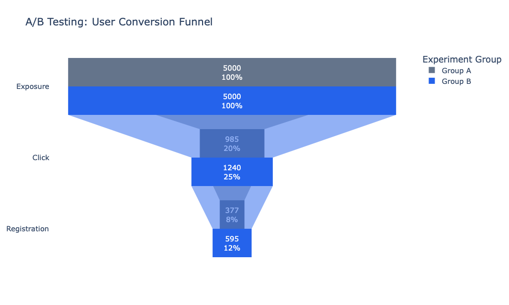
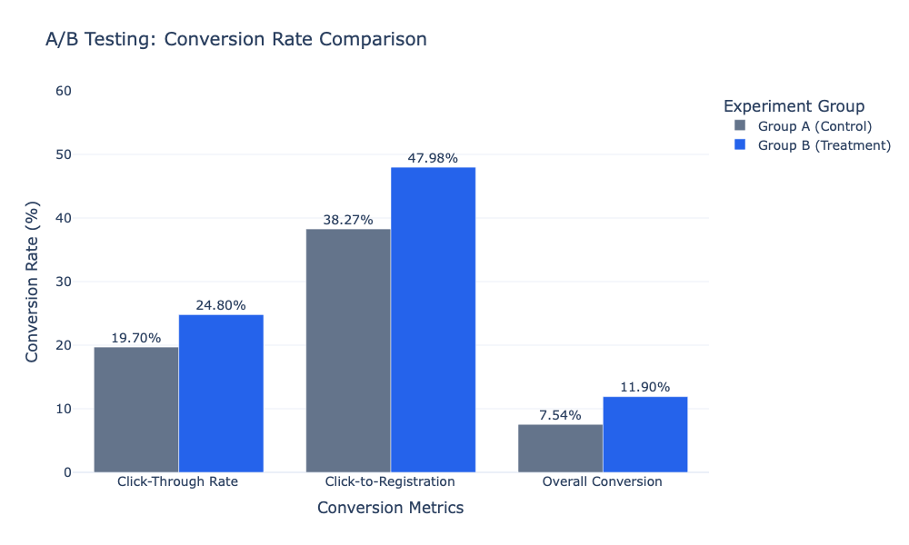
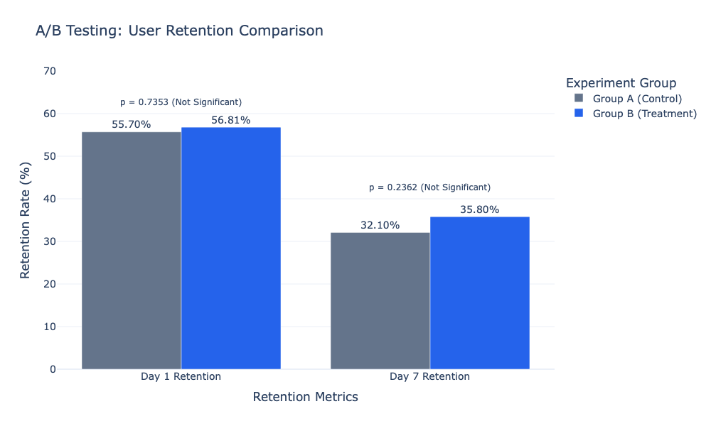

# A/B Testing & User Retention Analysis

**Python | Pandas | NumPy | SciPy | Statsmodels | Plotly | Product Analytics | A/B Testing**

## 1. Project Overview

This project demonstrates an end-to-end product analytics workflow to evaluate the effectiveness of a redesigned homepage call-to-action (CTA) button on user engagement, registration conversion, and retention.

Inspired by my previous internship experience in website analytics and A/B testing, this portfolio project reconstructs a comparable analytical workflow using synthetic data. No proprietary company data or original experimental results are included.

The analysis combines conversion funnel analysis, statistical hypothesis testing, user retention analysis, and interactive data visualization to support data-driven product decisions.

## 2. Business Problem

A digital platform is considering replacing its existing homepage CTA button with a redesigned version to improve user acquisition and registration.

The experiment compares:

- **Group A (Control):** Existing homepage CTA button
- **Group B (Treatment):** Redesigned homepage CTA button

The analysis addresses three business questions:

1. Does the redesigned button improve user engagement and registration conversion?
2. Is the observed improvement statistically significant?
3. Do users acquired through the redesigned experience demonstrate stronger short-term retention?

## 3. Dataset

The project uses a reproducible synthetic dataset containing **10,000 users**, evenly allocated between the control and treatment groups.

| Variable | Description |
|---|---|
| user_id | Unique user identifier |
| group | Experiment assignment (A or B) |
| exposed | Whether the user was exposed to the CTA |
| clicked | Whether the user clicked the CTA |
| registered | Whether the user completed registration |
| retained_d1 | Day 1 retention indicator |
| retained_d7 | Day 7 retention indicator |

**Data Source:** Programmatically generated synthetic user behavior data for educational and portfolio demonstration purposes.

## 4. Methodology

### 4.1 Data Preparation and Validation

- Generated synthetic user-level behavioral data.
- Checked missing values and duplicate user identifiers.
- Verified balanced experimental group allocation.
- Validated logical consistency across clicking, registration, and retention events.

All implemented data quality checks passed.

### 4.2 Conversion Funnel Analysis

Evaluated user progression through three stages:

**Exposure → Click → Registration**

Calculated three conversion metrics:

- Click-Through Rate (CTR)
- Click-to-Registration Rate
- Overall Registration Conversion Rate

Compared absolute percentage-point differences and relative improvements between the two groups.

### 4.3 Statistical Hypothesis Testing

Applied a two-sided two-proportion Z-test to evaluate the difference in overall registration conversion rates.

- **Null Hypothesis (H0):** The two groups have equal registration conversion probabilities.
- **Alternative Hypothesis (H1):** The registration conversion probabilities differ.
- **Significance Level:** 0.05

A 95% confidence interval was also calculated for the absolute conversion-rate difference.

### 4.4 User Retention Analysis

Analyzed Day 1 and Day 7 retention among registered users.

Calculated group-level retention rates and conducted exploratory two-proportion Z-tests to assess observed differences.

Because registration occurs after experimental assignment, comparisons conditional on registration should not be interpreted as unbiased causal effects of the treatment on retention.

## 5. Key Results

### 5.1 Conversion Performance

| Metric | Group A | Group B | Absolute Lift |
|---|---:|---:|---:|
| Click-Through Rate | 19.70% | 24.80% | +5.10 pp |
| Click-to-Registration Rate | 38.27% | 47.98% | +9.71 pp |
| Overall Registration Conversion | 7.54% | 11.90% | +4.36 pp |

The redesigned CTA group achieved a **57.82% relative improvement in overall registration conversion** in the simulated experiment.

### 5.2 Statistical Significance

| Statistic | Result |
|---|---|
| Z-statistic | 7.3591 |
| P-value | 1.85 × 10⁻¹³ |
| 95% Confidence Interval | [3.20, 5.52] pp |
| Statistical Decision | Reject H0 |

The simulated experiment provides strong statistical evidence of a difference in overall registration conversion rates, with Group B outperforming Group A.

### 5.3 User Retention

| Metric | Group A | Group B | P-value |
|---|---:|---:|---:|
| Day 1 Retention | 55.70% | 56.81% | 0.7353 |
| Day 7 Retention | 32.10% | 35.80% | 0.2362 |

Although Group B demonstrated slightly higher retention rates, neither difference was statistically significant at the 5% level.

## 6. Data Visualizations

### 6.1 User Conversion Funnel

Illustrates user progression from CTA exposure to clicking and registration across the two experimental groups.

### 6.2 Conversion Rate Comparison

Compares user engagement and conversion performance between the control and treatment groups.

### 6.3 User Retention Comparison

Visualizes Day 1 and Day 7 retention rates, including exploratory statistical significance results.

Interactive Plotly HTML versions of all three charts are available in the `Visualizations` folder.

## 7. Business Insights & Recommendations

**Finding 1 — Stronger Registration Conversion**

The treatment group achieved a statistically significant improvement in overall registration conversion, suggesting that the redesigned CTA could be a promising candidate for further product experimentation.

**Finding 2 — Retention Improvement Remains Uncertain**

The registered-user retention analysis did not detect statistically significant differences between groups. Additional evidence would be required to establish whether the redesign improves post-registration engagement.

**Finding 3 — Evaluate Downstream Outcomes**

Future experiments should include downstream metrics measured across all randomly assigned users, such as the proportion of users who register and remain active on Day 7.

**Recommendation**

The simulated results support considering the redesigned CTA for further controlled evaluation, while monitoring downstream engagement and product guardrail metrics before a full-scale rollout.

## 8. Tools & Technologies

- **Python:** End-to-end analytical workflow
- **Pandas & NumPy:** Data generation, manipulation, and aggregation
- **SciPy & Statsmodels:** Statistical hypothesis testing
- **Plotly:** Interactive conversion and retention visualizations
- **Google Colab / Jupyter Notebook:** Reproducible analysis environment
- **GitHub:** Version control and portfolio presentation

## 9. How to Run

1. Open `AB_Testing_User_Retention_Analysis.ipynb` in Google Colab or Jupyter Notebook.
2. Install the required Python libraries: `pandas`, `numpy`, `scipy`, `statsmodels`, and `plotly`.
3. Run the notebook cells sequentially to reproduce the synthetic dataset, statistical analyses, and visualizations.

## 10. Limitations

- All observations are synthetic and do not represent actual customer behavior.
- The simulation uses simplified behavioral assumptions.
- Statistical significance in simulated data does not establish real-world business effectiveness.
- Registered-user retention comparisons are exploratory and subject to post-treatment selection.
- Real-world deployment would require additional checks on randomization, tracking quality, sample size, experiment duration, and downstream product outcomes.

---

**Project Type:** Independent Portfolio Project — Synthetic Data Reconstruction

**Focus Areas:** Product Analytics | A/B Testing | Conversion Optimization | Statistical Analysis | User Retention
